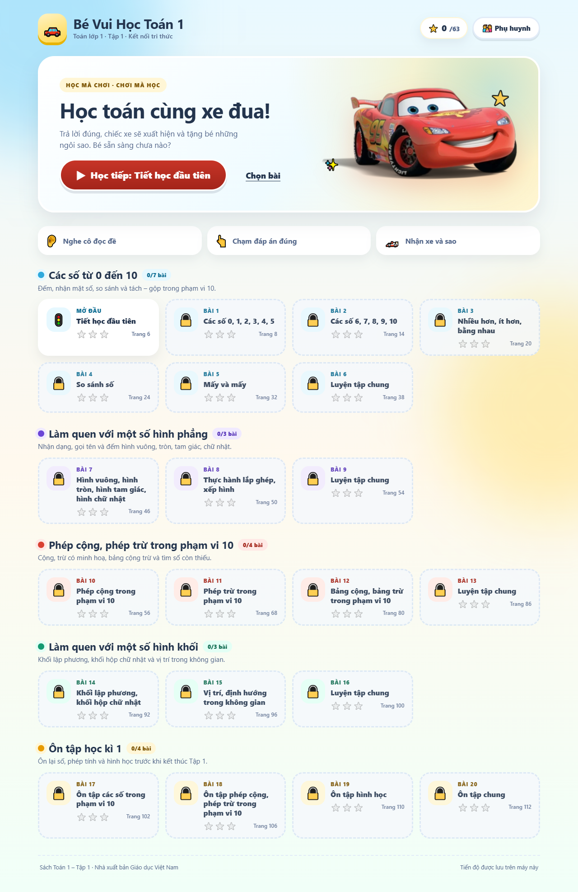

# Bé Vui Học Toán 1

Game web tĩnh dạy **Toán lớp 1 – Tập 1 (Kết nối tri thức với cuộc sống)** cho trẻ 6 tuổi.
Bé trả lời đúng để nhận **xe đua, sao và confetti**; sai thì được nhắc nhẹ và thử lại,
không bị trừ sao, không có màn thua, không có đồng hồ đếm ngược.

**Link cho tablet:** **https://be-vui-hoc-toan-1.onrender.com**



## Chạy game

**Cách 1 — mở trực tiếp (khuyến nghị):** nháy đúp `index.html` bằng Chrome hoặc Edge.
Không cần cài đặt, không cần mạng, không cần Node. Tiến độ lưu bằng `localStorage`
của trình duyệt.

**Cách 2 — chạy qua server tĩnh** (nếu trình duyệt chặn localStorage trên `file://`):

```powershell
cd "D:\Kid Math"
python -m http.server 8765 --bind 127.0.0.1
# mở http://127.0.0.1:8765
```

## Nội dung

21 màn bám đúng thứ tự và số trang sách Tập 1:

| Chủ đề | Màn | Trọng tâm |
|--------|-----|-----------|
| 1. Các số từ 0 đến 10 (tr. 6–45) | Mở đầu, Bài 1–6 | Đếm, nhận mặt số, nhiều/ít/bằng nhau, so sánh, mấy và mấy |
| 2. Một số hình phẳng (tr. 46–55) | Bài 7–9 | Hình vuông, tròn, tam giác, chữ nhật; đếm hình |
| 3. Cộng, trừ trong phạm vi 10 (tr. 56–91) | Bài 10–13 | Cộng, trừ có minh hoạ, bảng cộng trừ, tìm số thiếu |
| 4. Một số hình khối (tr. 92–101) | Bài 14–16 | Khối lập phương/hộp chữ nhật, trên–dưới–trái–phải |
| 5. Ôn tập học kì 1 (tr. 102–113) | Bài 17–20 | Ôn số, ôn cộng trừ, ôn hình học, ôn tổng hợp |

Bản đồ chi tiết từng màn: [`design/gdd/curriculum-map.md`](design/gdd/curriculum-map.md).

## Cách chơi

1. Chọn bài (mở khoá tuần tự; phụ huynh có thể mở tất cả).
2. Nghe đề đọc tiếng Việt hoặc bấm **Nghe lại**.
3. Chạm đáp án. Đúng ngay lần đầu: **+1 sao**, xe xuất hiện, confetti, lời khen.
   Đúng sau khi thử lại: xe và lời khen, không cộng sao lần đầu.
4. Hết bài: **1–3 sao** theo tỉ lệ đúng ngay lần đầu (≥90% = 3 sao, ≥60% = 2 sao).
5. Bài kế tiếp mở khi bài trước đạt ít nhất 1 sao.

Bàn phím: phím `1`–`4` chọn đáp án, `R` nghe lại, `Esc` về nhà.
Đáp án tối thiểu 64 px (86 px trên mobile); nút điều hướng 64 px (56 px trên máy nhỏ);
nút "Nghe lại" 56 px. Game tôn trọng `prefers-reduced-motion`.

**Cuộc đua:** mỗi bài có 4 tay đua — McQueen và **3 đối thủ** lấy từ 28 nhân vật
trong `Asset` (luân phiên để tất cả đều xuất hiện). Mở bài có màn xuất phát kiểu
`Feature.webp`: các xe đứng cạnh nhau ở vạch kẻ ca-rô, McQueen bên phải. Trong bài,
HUD 4 làn cho thấy ai đang dẫn; đúng ngay lần đầu McQueen tiến 1 bước, đúng sau khi
thử lại tiến 0,55 bước, sai thì đối thủ nhích nhẹ. Cuối bài có xếp hạng 1–4 và
podium; **không có màn thua**, sao vẫn theo số câu đúng ngay lần đầu.

**Dành cho bé chưa đọc tốt:** câu vị trí hiển thị **mũi tên lớn** `↑ ↓ ← →`;
câu so sánh nhóm dùng **badge số 1/2 kèm màu** và dấu `=`. Bé có thể chọn bằng mắt,
không cần đọc hết chữ. Giọng đọc vẫn đọc đề và lời khen khi máy có giọng Việt.

## Khu vực phụ huynh

Vào bằng nút **Phụ huynh** ở góc phải. Cổng bảo vệ là một phép nhân (ví dụ `9 × 9`),
đủ để bé lớp 1 không vào nhầm. Tại đây có:

- Tổng sao, số bài đã xong, số lượt chơi.
- Bảng sao từng bài theo 5 chủ đề.
- Bật/tắt giọng đọc tiếng Việt và hiệu ứng âm thanh.
- Mở khoá tất cả bài (hữu ích khi ôn tập).
- Đặt lại tiến độ (hai bước xác nhận).

Lưu ý: giọng đọc dùng Web Speech API của trình duyệt. Nếu máy chưa có giọng
tiếng Việt, game **không đọc bằng giọng sai ngôn ngữ** — bé vẫn học bằng chữ và hình,
màn Phụ huynh sẽ báo và hướng dẫn cài giọng trong cài đặt hệ điều hành/trình duyệt.

## Kiểm thử

**Test logic (không cần Node):** mở `tests/test-runner.html` trong trình duyệt.
Bộ test kiểm tra 65 mục: đọc số tiếng Việt, RNG tất định, cấu trúc 21 bài,
sinh hàng nghìn câu hỏi cho 11 dạng hoạt động, đáp án/phạm vi 0–10, tính sao,
mở khoá và lưu tiến độ.

```powershell
# Chạy smoke test tự động (Playwright dùng Chrome có sẵn)
python -m http.server 8765 --bind 127.0.0.1
python tools/smoke_test.py
```

Smoke test chơi thật 2 bài (có câu sai cố ý), kiểm tra xe/confetti/sao, mở khoá,
lưu tiến độ sau khi tải lại, khu phụ huynh, giao diện 8 dạng bài và layout mobile.
Ảnh chụp được lưu ở `production/qa/screenshots/`.

Nếu chưa có Playwright: `python -m pip install -r tools/requirements-test.txt`
(script dùng Chrome cài sẵn, không cần tải Chromium).

**Bản deploy tĩnh:** chạy `python tools/build_public.py` để tạo `public/` (khoảng 218 KB),
rồi mở `public/index.html` hoặc serve thư mục đó. Bản này đã được kiểm tra 21 bài,
ảnh xe, localStorage, không lỗi console.

## Chia sẻ lên tablet

**Đã deploy:** https://be-vui-hoc-toan-1.onrender.com (Render static site, commit `ffebecd`).
Mở link bằng Safari/Chrome trên tablet và “Thêm vào màn hình chính”.

Hướng dẫn cập nhật/deploy lại: xem [`DEPLOY-RENDER.md`](DEPLOY-RENDER.md). Gói upload
nằm ở `deploy/kid-math-render.zip` trên máy (tạo lại bằng `python tools/pack_deploy.py`;
file ZIP không commit vào repo). Cấu hình Render ở `render.yaml`: build `public/`,
publish `public`, HTTPS, không backend, không thu dữ liệu.

## Cấu trúc

```text
index.html                 # điểm vào duy nhất
css/tokens.css             # màu, chữ, bóng đổ
css/app.css                # toàn bộ giao diện + animation + responsive
js/core/                   # rng, số tiếng Việt, audio, speech, storage
js/data/tuning.js          # mọi thông số gameplay
js/data/curriculum.js      # 21 màn + đồ vật + hình học
js/data/racers.js          # McQueen + 28 nhân vật đối thủ, chọn 3 mỗi màn
js/domain/questions.js     # 11 dạng sinh đề (thuần hàm, không DOM)
js/domain/lesson-session.js# phiên học, tính sao
js/domain/race.js          # điểm đua, xếp hạng 1–4, không có trạng thái thua
js/domain/progress.js      # tiến độ, mở khoá, cài đặt
js/ui/race.js              # màn xuất phát kiểu Feature + HUD 4 làn
js/ui/visuals.js           # vẽ nhóm đồ vật, hình, phương trình, vị trí
js/ui/components.js        # sao, confetti, xe thưởng, toast
js/ui/screens/             # home, lesson, result, parent
js/app.js                  # composition root + router + splash
tests/                     # test runner trong trình duyệt
tools/smoke_test.py        # smoke test Playwright
design/                    # quick spec + bản đồ nội dung
docs/architecture/         # ADR-0001
production/                # QA, ảnh chụp, session state
```

## Quyết định thiết kế & giới hạn đã biết

- **Web tĩnh, không build**: xem [`docs/architecture/ADR-0001-static-offline-web-game.md`](docs/architecture/ADR-0001-static-offline-web-game.md).
- **Đồ vật minh hoạ bằng emoji**, hình/khối vẽ SVG cách điệu. Sách giấy không cho
  phép tái sử dụng tranh minh hoạ; sản phẩm chỉ dùng sách làm nguồn nội dung.
- **Ảnh xe & nhân vật** do người dùng cung cấp trong `Asset/`: `Mc_Queen.webp` là xe
  của bé, 28 nhân vật còn lại là đối thủ; tất cả đã có nền trong suốt.
- **Bài 15** dùng trên/dưới/trái/phải; "trước/sau" lược bỏ vì khó biểu diễn rõ trên 2D.
- **Mỗi bài 8 câu** (mở đầu 5, ôn tập chung 10), không phải toàn bộ bài tập trong sách.
- **Tiến độ** nằm trên máy, không đồng bộ đám mây, không thu thập dữ liệu trẻ em.
- **Giọng đọc** phụ thuộc giọng tiếng Việt của hệ điều hành/trình duyệt.

## Tài liệu

- Quick design spec: [`design/quick-specs/kid-math-web-2026-11-20.md`](design/quick-specs/kid-math-web-2026-11-20.md)
- ADR kiến trúc: [`docs/architecture/ADR-0001-static-offline-web-game.md`](docs/architecture/ADR-0001-static-offline-web-game.md)
- Bản đồ nội dung: [`design/gdd/curriculum-map.md`](design/gdd/curriculum-map.md)
- Trạng thái phiên làm việc: [`production/session-state/active.md`](production/session-state/active.md)

Phiên bản 1.0.0 · Nội dung tham chiếu *Toán 1 – Tập 1*, NXB Giáo dục Việt Nam.
